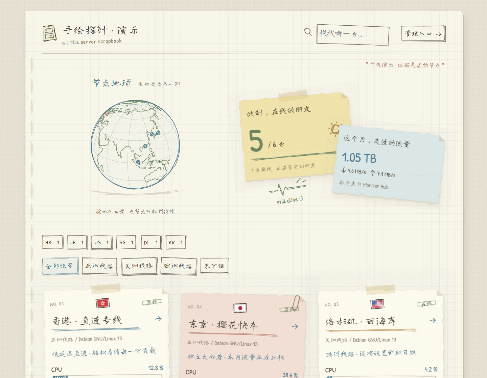

# monitor-hahaha

[Monitor](https://github.com/monitor-probe/monitor) 的手绘风公开状态页主题。用纸张卡片、手写文字和铅笔线条展示服务器的运行状态。



> 预览图中的节点和指标为虚构示例。

## 功能

- **纸张与手绘效果**：撕边卡片、胶带、折角，中英文手写字体，手绘按钮、进度条和图表。
- **节点状态**：展示 CPU、内存、磁盘、实时网速、本月流量、费用、到期时间和运行时长；区分离线、等待首次上报与读数异常。
- **节点地球**：手绘海岸线与经纬网，支持拖动、切换地区视角，点击节点进入详情。落点按国家或地区示意。
- **查找节点**：支持分组筛选，以及名称、公开备注和地区代码搜索。
- **历史记录**：查看资源与延迟曲线、丢包率，资源与延迟为独立页面，支持切换时间范围及浏览器返回；可选范围跟随 Hub 的历史保留天数。
- **实时更新**：接收实时快照，连接中断时尝试重连并使用轮询获取数据。
- **手机适配**：首页和节点详情支持小屏布局。
- **手绘国旗**：标准 SVG 图案叠加轻微低频形变、柔和颜色与 Rough.js 手绘边框。

字体和国旗随主题分发，无需外部字体或国旗 CDN。

## 安装

建议使用最新版 Monitor Hub。**从 GitHub 安装需要 Hub 1.3.2 或更新版本**。

### 从 GitHub 安装

1. 打开 Hub 后台的「主题」页。
2. 将下面的仓库地址粘贴到安装地址栏，点击「从 GitHub 安装」。
3. 安装完成后，选择并启用「手绘探针」。

```text
https://github.com/ayingQAQ/monitor-hahaha
```

### 上传安装

1. 打开 [最新正式 Release](https://github.com/ayingQAQ/monitor-hahaha/releases/latest)。
2. 下载附件 **theme.tar.gz**，在 Hub 的「主题」页上传安装。
3. 选择并启用「手绘探针」。

附件 **theme.sha256** 可用于校验安装包。请下载 Release 附件中的 `theme.tar.gz`，GitHub 自动生成的源码 ZIP 和 TAR.GZ 不能作为主题安装包。

## 主题设置

站长在 Hub 的主题设置中配置：

| 设置 | 默认值 | 说明 |
| --- | --- | --- |
| 站点公告 | 空 | 显示在页面顶部，按纯文本展示 |
| 墨水颜色 | 蓝色 | 可选蓝色、绿色或橙色 |

墨水颜色由站长在 Hub 主题设置中统一配置。

## 使用说明

- 主题短名为 **monitor-hahaha**，用于 Hub 的安装目录和主题设置。
- 节点名称、分组、备注、指标及历史记录由 Hub 提供；登录和节点管理使用 Hub 的内置后台。
- 历史记录超出保留期或没有采样时，不显示为正常的零值。
- 当前国旗素材覆盖 **257 个国家和地区代码**，支持大小写代码与 `UK` → `GB`。包括 `US`；未知代码显示手绘地球和地区代码。
- 有新版 Release 时，可在 Hub 的主题页使用更新功能。

安装与主题机制可参考 [Monitor 官方主题指南](https://monitor-document.pages.dev/dev/theme)。

## 许可证

主题代码使用 [MIT 许可证](LICENSE)，保留原作者及本项目的版权声明。

| 内容 | 许可证 |
| --- | --- |
| 主题代码 | [MIT](LICENSE) |
| 中文字体 Long Cang | [SIL Open Font License 1.1](public/fonts/LongCang-OFL.txt) |
| 英文字体 Patrick Hand | [SIL Open Font License 1.1](public/fonts/PatrickHand-OFL.txt) |
| 国旗基础图案 country-flag-icons | [MIT](public/flags/LICENSE.txt) |
| 地球地理数据 monitor-theme-rakugaki | [MIT](public/RAKUGAKI-LICENSE.txt) |
| 其他第三方组件 | 依各自许可证，见 [完整许可文本](THIRD_PARTY_NOTICES.txt) |

第三方素材的许可独立适用，来源见 [第三方说明](THIRD_PARTY.md)。
